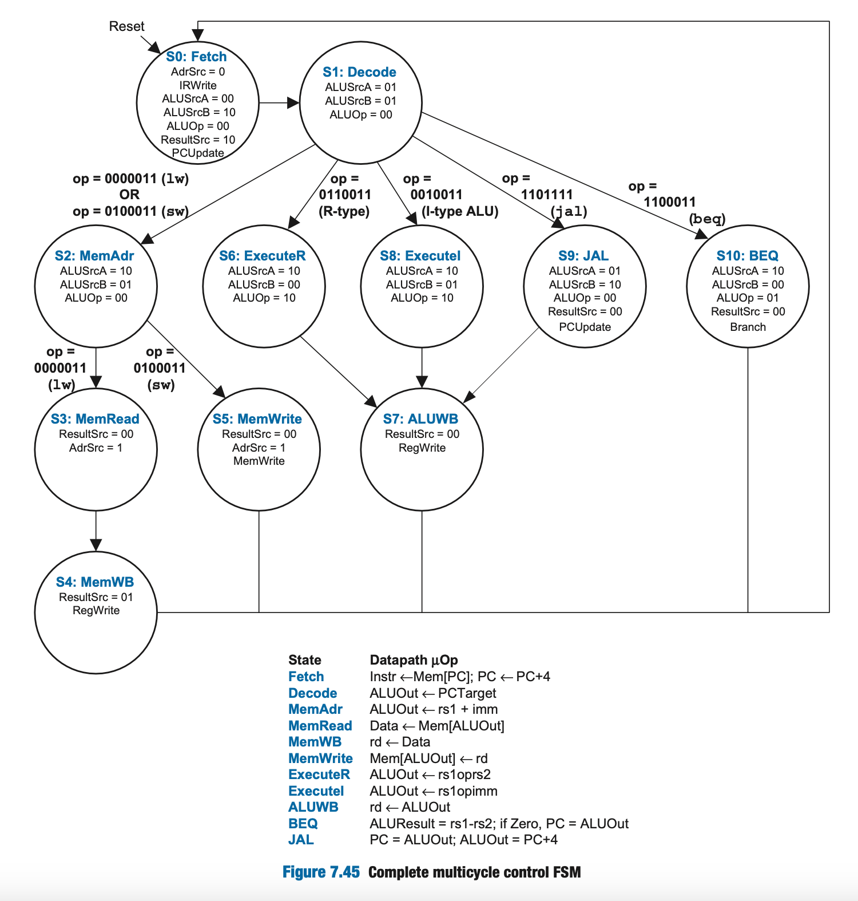

<h2 align="center"> CS 21 26.1 Laboratory Exercise 5 </h2>
<h1 align="center"> RISC-V Multi Cycle Processor </h1>

## Overview

In the lecture, we have derived the Multi Cycle Processor Datapath.  You will be using Logisim to modify an existing multicycle RISC-V processor implementation to support other kinds of instructions.

!!! warning "Ripes version"

    For uniformity, use the [https://ripes.upd-dcs.work](https://ripes.upd-dcs.work) instead of a locally installed RIPES.

## General Instructions

For this laboratory activity, you are to work on:

1. **Two Checkpoint Items** (due by the end of the lab period)
2. **Two Take-Home Items** (due before the next lab meeting)

## Relevant Links

- **Ripes Fork:** [https://ripes.upd-dcs.work](https://ripes.upd-dcs.work)
- **Lab 5 Logisim Template:** [https://drive.google.com/file/d/1lFRU2wb9Ypbz4tH-AI0bqT_M0WGh1nil/view?usp=sharing](https://drive.google.com/file/d/1lFRU2wb9Ypbz4tH-AI0bqT_M0WGh1nil/view?usp=sharing)

!!! tip "Tip: Quick conversion shell script"

    Recall from Lab 4, you learned how to generate a `logisim.txt` file that you can upload as an image into the instruction memory in Logisim. After copying the assembly version of your code from the Ripes simulator and saving it in `assembly.txt`, the following command automatically transforms the said output into its Logisim-ready form in `logisim.txt`:

    ```bash
    awk '
    BEGIN { print "v3.0 hex words" }
    $1 ~ /^[[:xdigit:]]+:$/ &&
    $2 ~ /^[[:xdigit:]]+$/ &&
    length($2) == 8 { print $2 }
    ' assembly.txt > logisim.txt
    ```

## Guided Walkthrough

### Overview

Download the Lab 5 Logisim Template using the link above. This file should contain a multicylce processor implementation that supports the following instructions:

- `lw`
- `sw`
- `add`
- `sub`
- `and`
- `or`
- `slt`
- `addi`
- `beq`
- `jal`

Note that the ALU is _incomplete_, causing R-type and I-type instructions not listed above to yield incorrect results.

### Walkthrough #1: Testing a simple R-type Instruction
To help you get familiarized with the processor, let's try running a simple `add x4, x1, x2` instruction. To see the effects of running this instruction, it is helpful to assign non-zero values to some of the registers.
    
1. Open the Register file and change the value of the following registers:
    - `x1 = 00000001`
    - `x2 = 00000002`
    - `x3 = 00000003`
        
2. Load the `add x4, x1, x2` instruction in hex (`0x00208233`) to the instruction memory
    
3. Go back to the  `mcpfull` main component and verify that the processor is still at `State 0` or the `Fetch` stage (without ticking the clock, the processor by default starts at the `Fetch` stage). The state number is labeled as `STATE` just below the control unit. Verify that the control signals are correct according to `State 0` of the FSM of the MCP Control Signals.

!!! warning "Volatile memory"

    Unlike the single-cycle processor in the previous lab, the memory component is set as _volatile_– everytime you reset the simulation, the entire address space _(**which includes loaded instructions**)_ is also reset to zero.

    This is done to ensure modifications to other parts of memory _(e.g., stack memory)_ do not persist through resets as this may make debugging harder.



4. Manually tick the clock at the lower left hand side of the circuit. Make sure that you tick once only. This should change the state of the processor to `State 1`.
    
5. Observe and verify that the changes of the control signals follow the control signals as the states change in this manner after `State 1` > `State 6` > `State 7` > `State 0
    
6. After executing the `add` instruction, verify that the changes to the register file is correct.

### Waltkthrough #2: Adding a Hypothetical `jal8` instruction
We will now add microarchitecture support for a hypothetical `jal8` instruction.

`jal8` is a hypothetical instruction that works like `jal`, but stores `PC + 8` instead of `PC + 4`. In other words, it has the following parallel goals:

- `REG[rd] = PC + 8`
- `PC = PC + SignExt(imm)`

Assume that executing `jal8` starts by performing `Fetch` and `Decode`. As such, we can assume that the architectural and nonarchitectural states of the multicycle processor are then as follows:

- `OldPC = PC`
- `PC = PC + 4`
- `A = REG[rs1]`
- `B = REG[rs2]`
- `ALUOut = PC + SignExt(imm)`

There are several ways to achieve the goals of `jal8` from here, with varying degrees of modification to the datapath and control.

The approach described below adds a new control state `JAL8` which is intended to follow after `Decode` if the instruction is a `jal8`.


### Designing a new `JAL8` control state

Since `ALUOut` already contains `PC + SignExt(imm)` after `Decode`, `JAL8` can simply set it as the value of `PC` to achieve the `PC = PC + SignExt(imm)` goal.

In particular, the following control signals must be set:

- `ResultSrc = 00` so that `ALUOut` is the output of the `Result` multiplexer
- `PCWrite = 1` so that `PC` is updated with the output of the `Result` multiplexer after the next triggering edge

This leaves the `REG[rd] = PC + 8` goal which involves writing to the register file. Recall that `PC` here refers to the _original_ `PC` value, which is stored in `OldPC` as `PC` is now `PC + 4` _(i.e., `PC = OrigPC + 4`)_.

Since the ALU is still unused in the `JAL8` state, we can compute `PC + 8` _(or more precisely, `OrigPC + 4 + 4`)_ in parallel via the following control signals:

- `ALUSrcA = 00` so that `PC` is the first ALU operand _(which contains `OrigPC + 4` at this point)_
- `ALUSrcB = 10` so that `4` is the second ALU operand
- `ALUOp = 00` so that `ALUControl` is set to `000` _(addition)_

The only step left is to write this sum to `REG[rd]`.

Recall that:

- We have already set the `Result` multiplexer to output `ALUOut` via `ResultSrc = 00`
- The `WD3` port of the register file _(which dictates the value to be written)_ is _also_ connected to the output of the `Result` multiplexer
- Our remaining goal is to write `PC + 8` to `REG[rd]`

Given the above, we will be unable to write `PC + 8` to `REG[rd]` in parallel with writing `OldPC + SignExt(imm)` to `PC`.

While we can move the execution of `REG[rd] = PC + 8` to another new state after `JAL8`, recall that:

- `ALUOut` automatically saves the result of the ALU computation of the previous cycle
- The existing `ALUWB` operation performs `REG[rd] = ALUOut`

As such, doing `PC + 8` during the `JAL8` cycle will allow us to perform `REG[rd] = PC + 8` by doing `ALUWB` after.

In summary, the new `JAL8` control state sets the following control signals:

- `ResultSrc = 00`
- `PCWrite = 1`
- `ALUSrcA = 00`
- `ALUSrcB = 10`
- `ALUOp = 00`
- `RegWrite = 0` _(since the register file must not yet be written to)_
- `MemWrite = 0` _(since memory must not be written to)_
- `IRWrite = 0` _(since `Instr` and `OldPC` must not be updated)_

Doing so results in the following state changes:

- `PC = OldPC + SignExt(imm)`
- `ALUOut = OrigPC + 8`

`jal8` can thus be handled using the following four-cycle sequence:

| Cycle | Operation | Resulting state after triggering edge
|:-:|:-:|-|
| 1 | `Fetch` | `PC = OrigPC + 4`<br>`OldPC = OrigPC`<br>`Instr = MEM[OrigPC]`<br>`A = 💩`<br>`B = 💩`<br>`ALUOut = 💩`<br>`REG[rd] = 💩`
| 2 | `Decode` | `PC = OrigPC + 4`<br>`OldPC = OrigPC`<br>`Instr = MEM[OrigPC]`<br>`A = REG[rs1]`<br>`B = REG[rs2]`<br>`ALUOut = OrigPC + SignExt(imm)`<br>`REG[rd] = 💩`
| 3 | `JAL8` | `PC = OrigPC + SignExt(imm)`<br>`OldPC = OrigPC`<br>`Instr = MEM[OrigPC]`<br>`A = REG[rs1]`<br>`B = REG[rs2]`<br>`ALUOut = PC + 8`<br>`REG[rd] = 💩`
| 4 | `ALUWB` | `PC = OrigPC + SignExt(imm)`<br>`OldPC = OrigPC`<br>`Instr = MEM[OrigPC]`<br>`A = REG[rs1]`<br>`B = REG[rs2]`<br>`ALUOut = 💩`<br>`REG[rd] = OrigPC + 8`


### Implementing the new state

Before implementing new `JAL8` state, we first have to assign a state value to it. Since `S0` up to `S10` are already used, we can use `S11`.

To implement the new `JAL8` state, follow these steps:

1. Open the `controlunit` implementation. Verify that the following subcircuits are present:

- `maindecoder` – Moore circuit computing almost all of the control signals
- `nextstatelogic` – Combinational circuit controlling state transitions
- `aludecoder` – Combinational circuit computing `ALUControl`
- `instrdecoder` – Combinational circuit computing `ImmSrc`

Of the subcircuits listed, only the ALU decoder does not need to be modified for `JAL8` as there were no changes made to the operation of the ALU.

**Main Decoder** Open up `maindecoder` and verify that you can see how each control signal is computed using only the current state.

!!! example "Do now!"

    Assuming that the current state is `Decode` _(`S1` or `0001`)_, identify the values emitted by `maindecoder` for the following based on its Logisim implementation:

    - `PCUpdate`
    - `Branch`
    - `MemWrite`
    - `IRWrite`
    - `RegWrite`
    - `AdrSrc`
    - `ALUSrcA`
    - `ALUSrcB`
    - `ALUOp`
    - `ResultSrc`

    Note that floating values _(i.e., `U`)_ are taken to be _don't cares_ _(i.e., `X`)_.

Recall that our new `JAL8` state is assigned to `S11` and that it must set the following control signals as follows:

- `ResultSrc = 00`
- `PCWrite = 1`
- `ALUSrcA = 00`
- `ALUSrcB = 10`
- `ALUOp = 00`
- `RegWrite = 0`
- `MemWrite = 0`
- `IRWrite = 0`

Recall that `PCWrite` is indirectly influenced by `maindecoder` via the `PCUpdate` and `Branch` control signals _(where `PCWrite = PCUpdate | (Branch & Zero)`)_. Since `PCWrite` must always be `1` for `JAL8`, it should set `PCUpdate` to `1`.

!!! example "Do now!"

    For each control signal computed in `maindecoder`, locate its input port labeled "input 11" _(corresponding to S11)_, then add a `Constant` component corresponding to the value `JAL8` is supposed to set the said control signal to.

    Ensure that the existing connections are kept intact.

    To verify your implementation, you may use the Poke tool to manually set the individual bits of the `State` input and confirm that the outputs shown are as intended.


**Next State Logic.** Open up the `nextstatelogic` and examine how `NextState` is being computed from the current state and the current instruction.

!!! example "Do now!"

    Recall that `S1 (Decode)` has the following next state transitions:

    - `S2 (MemAddr)` if current instruction is `lw` or `sw`
    - `S6 (ExecuteR)` if current instruction is `lw` or `sw`
    - `S8 (ExecuteI)` if current instruction is an I-type ALU
    - `S9 (JAL)` if current instruction is `jal`
    - `S10 (BEQ)` if current instruction is `beq`

    Ensure that you understand how a priority encoder is used to determine which kind of instruction is being executed.

    Verify that the implementation for `NextS1` is consistent with the state transitions listed above for `S1 (Decode)`.

    Verify as well that the implementation for `NextState` ensures that `NextS1` will be selected when the current state is `S1 (Decode)`.

Recall that we want the `JAL8` state to come after the `Decode` state, but only when executing the `JAL8` instruction, and that we want `ALUWB` to come after `JAL8`.

To do this, we need to be able to detect that the current instruction being executed is `JAL8`. We will define `JAL8` as having an opcode of `0b1101110` or `0x6e`.

!!! example "Do now!"

    To make `S1 (Decode)` transition to `S11 (JAL8)` when the current instruction is `JAL8`, do the following:

    - Add a new comparator that compares the `opcode` _(using a tunnel)_ and `0010111` _(as a constant)_, then set the equality result to a new `IsJAL8` tunnel

    - Add another `IsJAL8` tunnel to "Input 6" of the priority encoder used to generate `Selector`

    - Set the value of the "Input 6" port of the multiplexer computing `NextS1` to `b` _(corresponding to `S11 (JAL8)`)_

    To make `S11 (JAL8)` transition to `S7 (ALUWB)` regardless of the current instruction, do the following:

    - Create a new tunnel `NextS11` and set its input to `7` _(corresponding to `S7 (ALUWB)`)_

    - Connect another `NextS11` tunnel to the "Input 11" port of the multiplexer computing `NextState`

    Ensure you understand the reason why each step was done.


**Instruction decoder and extend unit.** Recall that the instruction decoder is in charge of computing `ImmSrc`, which is used by the extend unit to determine how the immediate value will be constructed from the instruction bits. Also, recall that J-type instructions correspond to `ImmSrc = 011`. Open up `instrdecoder` and verify that the instruction detection logic is similar to that of `nextstatelogic`.

!!! example "Do now!"

    Add a comparator and `IsJAL8` tunnels similar to the previous section, then set the value of "Input 6" port of the multiplexer computing `ImmSrc` to `3` _(which corresponds to `0b011`)_.

**Verification.** The changes in the earlier sections should be enough for the multicycle processor to properly execute the `jal8` instruction.

To check whether you have implemented `jal8` correctly, you may use this simple test program:

```mips
add x0, x0, x0  # 0:  00000033
jal8 x1, 12     # 4:  00c000ee
add x1, x1, x1  # 8:  001080b3
add x1, x1, x1  # c:  001080b3
add x0, x0, x0  # 10: 00000033
```

After execution of the test program, `x1` is expected to have a value of `0xc` with all other general-purpose registers equal to `0x0`.


!!! example "Do now!"

    Enter the corresponding machine instructions in the memory of the multicycle processor, then tick the clock until it says `12` ticks _(or when the stated `PC` value is `0x14`)_.

    Verify that the register values shown in the **State** tab of Logisim are consistent with the register values shown above.

!!! warning "Verification of existing instructions"

    The test above does not verify whether the other supported instructions still work as intended.

    You are strongly encouraged to make a more comprehensive test program that involves `lw`, `sw`, `add`, `sub`, `and`, `or`, `slt`, `addi`, `beq`, and `jal`.

## Checkpoint Tasks

### Checkpoint Item 1: Ensure that your JAL8 implementation is working  (20/100)
Call the attention of the lab handler and show that you have successfully implemented `JAL8` by showing that the test program above gets the correct behavior and changes to register file and `PC`.

### Checkpoint Item 2: Make the MCP capable of running  `bne`  (40/100)

Modify the given Logisim circuit to add a new state say `State 12` to support the B-type instruction `bne`.

Ensure that all other instructions that were supported before by the template still work as intended. What are the state transitions for the `bne` and how many cycles does it take to finish execution?

You are allowed to use tunnels.

Save the resulting circuit as `lab05_checkpoint.circ`.


## Take Home Problems
### Item 1: Make the MCP capable of running  `xori`  (20/100)

Starting from the working MCP template after the Walkthrough, add microarchitecture support for an `xori` instruction. 

Ensure that all other instructions that were supported before by the template still work as intended. What new state did you have to create, if any?

You are allowed to use tunnels.

Save this working circuit as `lab05_takehome1.circ`. 


### Item 2: MCP Capable of `sll` (20/100)
Starting from the working MCP circuit capable of `xori` from Take Home Problem Item 1, add microarchitecture support for a `sll` instruction. Save this working circuit as `lab05_takehome2.circ`

