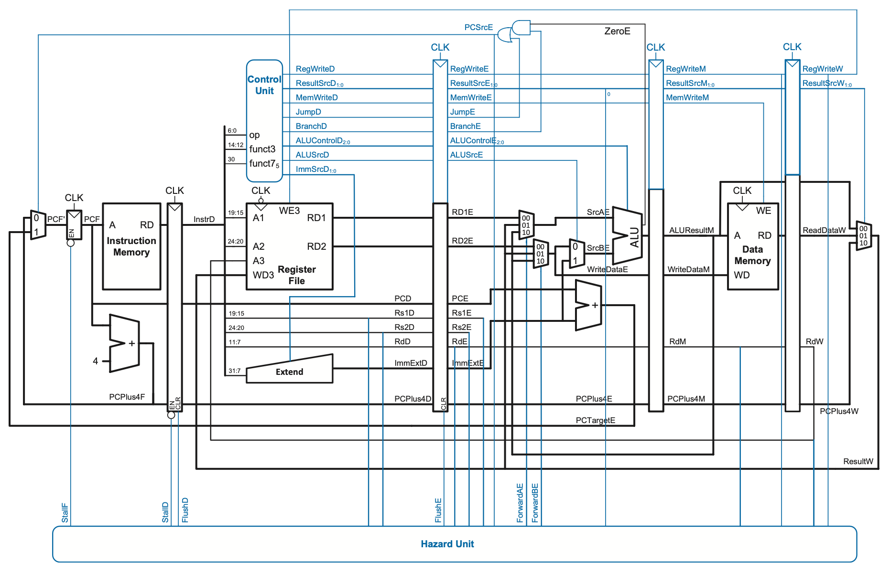

<h2 align="center"> CS 21 26.1 Laboratory Exercise 6 </h2>
<h1 align="center"> Pipelined Processor in Logisim </h1>

## Overview

In the lecture, we introduced the RISC-V Pipelined Processor.  In this lab activity, you will be using Logisim to modify an existing pipelined RISC-V processor implementation to support other kinds of instructions.

## General Instructions

In the Laboratory 6 Walkthrough you were given a guided activity for navigating the Pipelined processor implementation in Logisim. In this laboratory activity, you are to work on

1. **1 Checkpoint Item** (worth 70 points)

## Relevant Links

- **Ripes Fork:** [https://ripes.upd-dcs.work](https://ripes.upd-dcs.work)
- **Lab 6 Logisim Template:** [https://drive.google.com/file/d/1YIG0GWN8k4u7n-qk0t6r8i7NrUMPpal9/view?usp=sharing](https://drive.google.com/file/d/1YIG0GWN8k4u7n-qk0t6r8i7NrUMPpal9/view?usp=sharing)

### Preliminary Task
Before you proceed with the Checkpoint task, download a copy of the Lab 6 Logisim Template and do the following preliminary tasks:

### Basic execution
Before moving forward, do the following:

1. Select **Simulate > Reset Simulation** _(or hit `Ctrl/Cmd-r`)_ to restart the simulation state.

2. Observe that `PC4F` _(i.e., the `PC + 4` value in the Fetch stage)_ is currently at `0x4` and that `NextPC` is also at `0x4`. Ensure you are able to follow how the implementation is able to compute this.

3. Notice as well that `PC4D`, `PC4E`, `PC4M`, and `PC4W` are currently at `0x0`.

4. Select **Simulate > Manual Tick Half Cycle** twice or **Simulate > Manual Tick Full Cycle** once _(preferably using their keyboard shortcuts)_ to cause the next triggering edge to occur. Notice that the `0x4` value of `PC4F` has now moved to `PC4E`, and that `PC4F` is now `0x8`.

5. Tick the clock once more to see the said values move one stage. Before moving forward, ensure that `PC4F` is `0xc`, `PC4D` is `0x8`, and `PC4E` is `0x4`.


### Manual hazard resolution

The template does **not** have any forwarding or hazard resolution implemented. To perform _manual_ hazard resolution, the top-left corner of the template provides input pins for `StallF`, `StallD`, `FlushD`, and `FlushE` that can be manually set with the **Poke** tool. Before proceeding, try to do the following and observe the behavior of the processor:

1. Use the **Poke** tool to set `StallF` to `1`, then tick the clock. Verify that `PC4F` is _still_ `0xc`, but `PC4D` is _also_ `0xc`. Ensure you understand why that is the case before proceeding.

2. Set `StallF` to `0`, then tick the clock once; `PC4F` should now be `0x10` while `PC4D` should be `0xc`. Then, set both `StallF` and `FlushD` to `1`. Verify that `PC4F` and `PC4D` are unaffected, then tick the clock. What happened to `PC4F` and `PC4D`?

3. Set both `StallF` and `FlushD` to `0`, then tick the clock **thrice**; `PC4F` should now be `0x1c` while `PC4D` should be `0x18`. Verify as well that `PC4E` is `0x14` and `PC4M` is `0x10`.

4. Finally, think about what setting `StallF`, `StallD`, and `FlushE` to `1` would do, then verify your hypothesis by setting them to `1`, ticking the clock, and checking the values of `PC4F`, `PC4D`, `PC4E`, `PC4M`, and `PC4W`.

## Checkpoint Tasks

### Checkpoint Item 1: Designing the Forwarding + Hazard Unit (70/100 points)

Modify the given Logisim circuit such that:

- A subcircuit named `hazardunit` that detects and resolves hazards is present
- `hazardunit` is placed in the `main` circuit to serve as its hazard unit
- The datapath accommodates forwarding as discussed in class

For your convenience, the complete hazard unit logic is as follows:

| Output | Logic |
| :-: | - |
| `ForwardAE = 10` (priority) | `(Rs1E == RdM) & RegWriteM & (Rs1E != 0)` |
| `ForwardAE = 01` | `(Rs1E == RdW) & RegWriteW & (Rs1E != 0)` |
| `ForwardAE = 00` | Otherwise |
| `ForwardBE = 10` (priority) | `(Rs2E == RdM) & RegWriteM & (Rs2E != 0)` |
| `ForwardBE = 01` | `(Rs2E == RdW) & RegWriteW & (Rs2E != 0)` |
| `ForwardBE = 00` | Otherwise |
| `lwStall` _(not used outside the hazard unit)_ | `ResultSrcE_0 & ((Rs1D == RdE ) | (Rs2D == RdE))` |
| `StallF` | `lwStall` |
| `StallD` | `lwStall` |
| `FlushD` | `PCSrcE` |
| `FlushE` | `lwStall | PCSrcE` |

!!! warning "Flushing behavior implication"

    Note that the way `FlushD` and `FlushE` are computed implies that the processor employs static branch prediction with a branch-not-taken default.

The complete datapath forwarding logic is as follows:

| Control signal | Effect |
| :-: | - |
| `ForwardAE == 00` | `RD1E` is first ALU operand |
| `ForwardAE == 01` | `ResultW` is first ALU operand |
| `ForwardAE == 10` | `ALUResultM` is first ALU operand |
| `ForwardBE == 00` | `RD2E` is both `WriteDataE` value and port `0` input of `ALUSrcE` multiplexer |
| `ForwardBE == 01` | `ResultW` is both `WriteDataE` value port `0` input of `ALUSrcE` multiplexer |
| `ForwardBE == 10` | `ALUResultM` is both `WriteDataE` value port `0` input of `ALUSrcE` multiplexer |

The complete pipelined processor diagram may be found below for your convenience:



Ensure that:

- All other instructions that were supported before by the template still work as intended
- The input pins for `StallF`, `StallD`, `FlushD`, and `FlushE` in the top-right corner of the `main` circuit are deleted

You are encouraged to use tunnels and comparators.

Save the resulting circuit as `lab06checkpoint.circ`.

!!! tip "Hint: Priority encoders"

    You may find priority encoders more useful in deriving an implementation of a conditional statement over a implementing with a truth table.


### Test Program

!!! tip "Tip: Quick conversion shell script"

    Supposing the output of the Ripes assembly is in `assembly.txt`, the following command automatically transforms the said output into its Logisim-ready form in `logisim.txt`:

    ```bash
    printf "v3.0 hex words\n%s" "$(cat assembly.txt | grep "^\s" | tr -s " " | cut -d " " -f 3)" > logisim.txt
    ```

You may test your work using the following RISC-V program and compare the resulting register values in the **State** tab after 37 clock cycles with those of Ripes:

```mips
main:
    addi s0, zero, 100    # s0 = 100

    addi t0, zero, 5      # t0 = 5
    addi t1, zero, 10     # t1 = 10
    add  t2, t0, t1       # t2 = 15
    add  t3, t2, t0       # t3 = 20 (forwarding)

    addi t4, zero, 7      # t4 = 7
    sw   t4, 0(s0)        # MEM[100] = 7
    lw   t5, 0(s0)        # t5 = 7
    addi t6, zero, 3
    add  t1, t5, t6       # t1 = 10 (forwarding)

    lw   t2, 0(s0)        # t2 = 7
    add  t3, t2, t0       # t3 = 12 (load-use stall)

    addi t0, zero, 1      # t0 = 1
    addi t1, zero, 2      # t1 = 2
    beq  t0, t1, skip1    # Not taken (forwarding; should not flush)

    addi t2, zero, 99     # t2 = 99

skip1:
    addi t0, zero, 3      # t0 = 3
    addi t1, zero, 3      # t1 = 3
    beq  t0, t1, taken1   # Taken (forwarding; should flush)

    addi t2, zero, 111    # Should be flushed

taken1:
    jal  t0, func         # t0 = PC + 4 (initial fetch should be flushed)
    addi t3, zero, 222    # Should be flushed

after:
    beq  zero, zero, end  # Taken (should not trigger forwarding)

func:
    addi t4, zero, 42     # t4 = 42
    jal  zero, after      # return (no ra needed)

end:
    beq zero, zero, end   # Infinite loop
```
